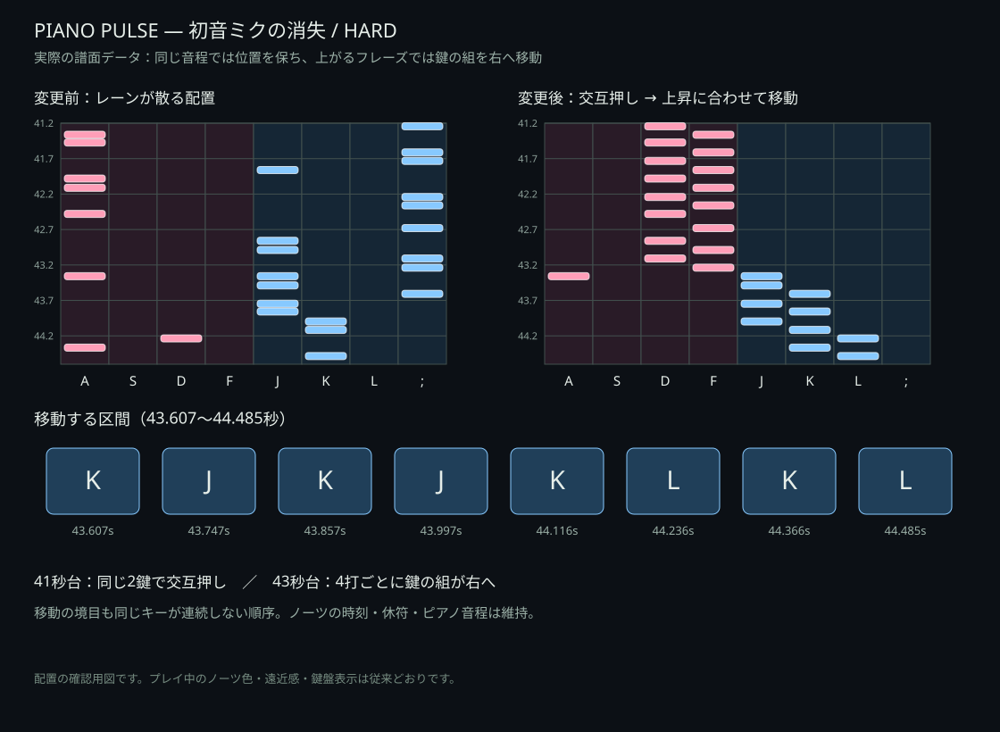

# トリル・移動トリル v17

旧譜面では音域の輪郭から毎回レーンを選び、同じキーが続くと別の手へ移していたため、同じ2鍵を連続して交互に叩く形が保たれていませんでした。変更前の初音ミクの消失・激唱・マシンガンポエムドール・ヤミナベ!!!!・What's up? Pop!・テトリス・メズマライザーを調べると、単押しだけの速い6打以上のトリルはありませんでした。

## 変更内容

7曲のNORMAL / HARDに計80区間のトリルを追加しました。そのうち63区間は、フレーズの音高変化に合わせて鍵の組が移動します。消失はNORMAL 7区間、HARD 12区間です。EASYと他28曲の配置は変更していません。

- 4打の中では2鍵を交互に叩き、同じ音階が続く区間は位置を維持します。
- 4打単位で音高を平滑化し、上昇では鍵の組を右へ、下降では左へ1レーンずつ移します。大きな音域跳躍は輪郭の支持も確認し、倍音やオクターブの推定違いだけで飛ばないようにしています。
- `A B A B → B C B C` の境目で `B B` とならないよう、次のブロックの順番を入れ替えます。移動しても同じキーが連続しません。
- ロングで保持中のキーと、FLOAT判定中のキーは避けます。選んだ区間にはロング・同時押し・FLOATを混ぜず、既存のそれらのノーツは動かしていません。
- 譜面の元となる音声アタックの時刻と短い休符を維持しています。トリルのために等間隔のノーツを追加したり、発音時刻をずらしたりはしていません。

## 消失の例

HARDの41.243〜43.238秒は同じ2鍵の交互押し。続く43.607〜44.485秒は、上昇する音高に合わせて鍵の組を右へ移します。57秒台には下降する移動トリルがあります。終盤にも186秒台・226秒台・252秒台・268秒台などにトリルを配置しています。

## 確認範囲

詳細な区間・時刻・各ブロックのキーは [trills-v17.json](trills-v17.json) に記録しています。全35曲・105譜面・95,730ノーツを変更前と比較し、レーンが変わった653ノーツが対象区間内だけにあること、音声時刻・ピアノ音程・ノーツ数・ロング・同時押し・FLOATの時刻と数が不変であることを検査しました。

83件のテストで、4打ブロックの2鍵交互押し、上昇・下降する移動、境目の同キー連打防止、保持中レーン回避、全曲の満点入力再生とサーバー採点を検査しています。音高・音域輪郭は原音声からの推定を含みます。耳で全曲を通し演奏した検査ではありません。

`trill-data.mjs` は選んだフル動画上の区間と、その範囲の音高・輪郭のスナップショットです。ピアノ音の将来の調整で譜面配置が勝手に変わらないよう独立しています。`node tools/build-trill-data.mjs` で生成できます。元音声・歌詞・第三者の譜面やMIDIは配信しません。

譜面バージョンを `piano8-trills-v17` に更新し、ブラウザとオンライン採点で同じ配置を使います。以前の記録は削除せず、以前の譜面バージョンに保持します。
